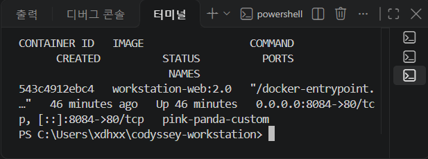
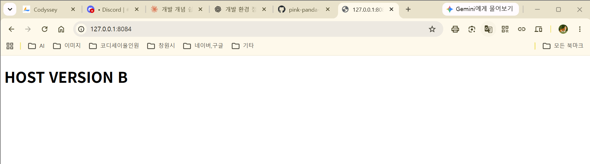
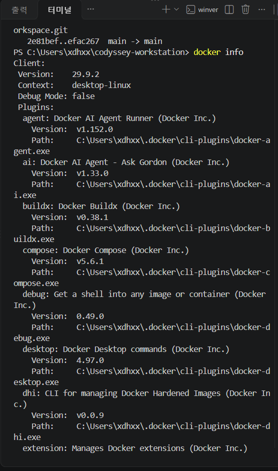
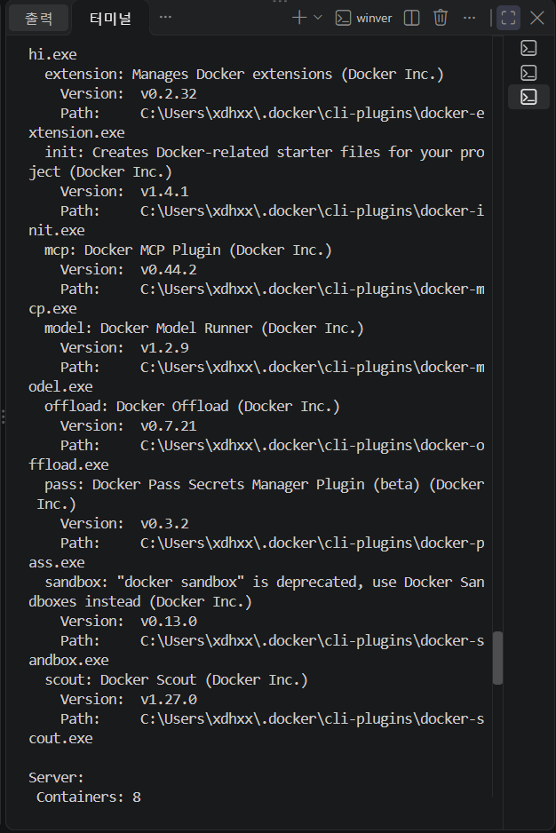
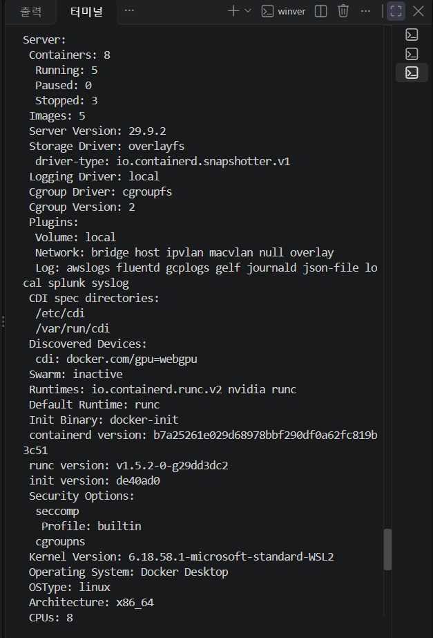
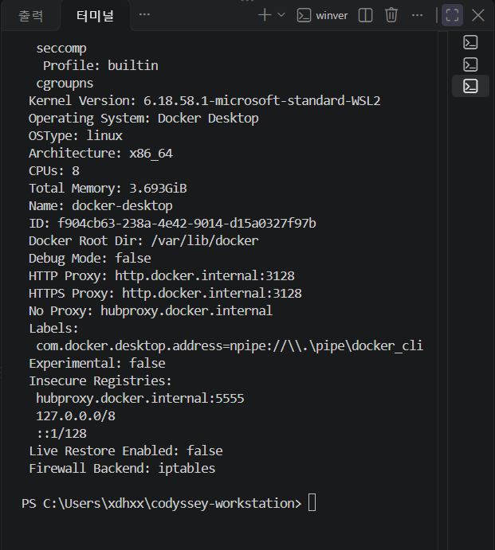
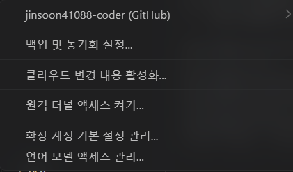

# pink-panda-dev-workspace

## 내 컴퓨터에 개발자용 '작업실' 꾸미기


## 🌸 미션 소개

이 프로젝트는 개발자용 작업실을 직접 구축하고
기본 개발 도구를 익히기 위한 학습 프로젝트입니다.

## 💻 개발 환경

- 운영체제: Windows 11
- 개발 도구: Visual Studio Code
- Linux 환경: WSL2 Ubuntu
- 컨테이너: Docker
- 버전 관리: Git
- 원격 저장소: GitHub

## 🐼 주요 학습 내용

### 1. Linux 기본 명령어
- pwd, ls, cd 명령어 사용
- 파일과 폴더 생성 및 이동
- 파일 권한 이해하기

### 2. Docker 실습
- Docker 이미지 만들기
- Docker 컨테이너 실행
- Dockerfile 작성
- 포트 매핑과 볼륨 이해하기

### 3. Git과 GitHub
- Git 저장소 생성
- 파일 추가 및 커밋
- GitHub 저장소 연결
- git push와 git pull 실습

## 🏆 학습 목표

개발 환경을 직접 구축하고
Docker, Linux, Git, GitHub의 기본 개념을
스스로 설명할 수 있도록 성장하겠습니다.

## 💗 나의 다짐

포기하지 않고 꾸준히 공부하겠습니다!

🐼 Pink Panda Developer Workspace
  ## 📚 실습 보고서

[🐼 개발자 작업실 실습 보고서 보기](docs/WORKSTATION.md)
## 🐳 Docker 실습 웹페이지

[🐼 핑크판다 Docker 웹페이지 코드 보기](web-demo/site/index.html)

[🐳 Dockerfile 확인하기](web-demo/Dockerfile)
## 📸 과제 수행 증거 사진

### 1. Docker 컨테이너 실행



### 2. Docker 웹서버 실행 및 포트 연결



### 3. Docker 엔진 실행 환경









### 4. VS Code GitHub 로그인 확인



## 🐼 미션 목표 6가지 설명

### 1. 절대 경로와 상대 경로의 차이

**절대 경로**는 최상위 디렉터리부터 시작하는 전체 경로입니다.

예시: `/home/jin/pink-panda-workspace`

**상대 경로**는 현재 작업 중인 디렉터리를 기준으로 나타내는 경로입니다.

예시: `./docs/WORKSTATION.md`

**동료평가 설명:**
> 절대 경로는 파일의 전체 주소이고, 상대 경로는 현재 위치를 기준으로 파일을 찾아가는 주소입니다.

### 2. 파일 권한(r/w/x)과 755, 644의 의미

Linux에서는 파일과 디렉터리에 읽기, 쓰기, 실행 권한을 설정할 수 있습니다.

- `r` (Read): 읽기 권한, 숫자 4
- `w` (Write): 쓰기 권한, 숫자 2
- `x` (Execute): 실행 권한, 숫자 1

**755 권한**
- 소유자: 7 = 4+2+1 (rwx)
- 그룹: 5 = 4+1 (r-x)
- 기타 사용자: 5 = 4+1 (r-x)

**644 권한**
- 소유자: 6 = 4+2 (rw-)
- 그룹: 4 = 읽기만 가능 (r--)
- 기타 사용자: 4 = 읽기만 가능 (r--)

**실습 명령어**
```bash
chmod 755 hello.sh
chmod 644 hello.txt
```

**동료평가 설명:**
> Linux 파일 권한은 읽기, 쓰기, 실행으로 구분됩니다. 755는 소유자에게 모든 권한을 주고, 644는 소유자에게 읽기와 쓰기 권한을 주는 설정입니다.

### 3. Dockerfile을 이용한 커스텀 이미지 만들기

Docker 커스텀 이미지는 기존 이미지를 기반으로 필요한 파일과 설정을 추가하여 직접 만든 이미지입니다.

**Dockerfile 예시**
```dockerfile
FROM nginx:alpine
COPY index.html /usr/share/nginx/html/index.html
```

- `FROM`: 사용할 기본 이미지 지정
- `COPY`: 웹페이지 파일을 이미지 내부로 복사

**이미지 빌드 명령어 예시**
```bash
docker build -t pink-panda-web:1.0 .
```

- `docker build`: Docker 이미지 생성
- `-t`: 이미지 이름과 태그 지정
- `.`: 현재 폴더를 빌드 컨텍스트로 사용

**동료평가 설명:**
> Dockerfile에 기본 이미지와 필요한 설정을 작성하고 docker build 명령어를 실행하여 나만의 커스텀 이미지를 만들 수 있습니다.

### 4. Docker 포트 매핑이 필요한 이유

Docker 포트 매핑은 컴퓨터의 포트와 Docker 컨테이너의 포트를 연결하는 기능입니다.

**포트 매핑 명령어 예시**
```bash
docker run -d -p 8084:80 --name pink-panda-demo workstation-web:2.0
```

- `docker run`: 컨테이너 실행
- `-d`: 백그라운드 실행
- `-p 8084:80`: 컴퓨터 8084번 포트와 컨테이너 80번 포트 연결
- `--name`: 컨테이너 이름 지정

**웹페이지 접속 주소**

http://localhost:8084

**동료평가 설명:**
> Docker 컨테이너 안에서 실행되는 웹서버에 외부 브라우저로 접속하려면 포트 매핑이 필요합니다. 저는 컴퓨터의 8084번 포트와 컨테이너의 80번 포트를 연결하여 웹페이지에 접속하는 실습을 했습니다.

### 5. Docker 볼륨(영속 데이터)의 의미

Docker 볼륨은 컨테이너가 삭제되어도 데이터를 유지할 수 있도록 Docker가 관리하는 저장 공간입니다.

**볼륨 생성 명령어**
```bash
docker volume create pink-panda-data
```

**볼륨 목록 확인**
```bash
docker volume ls
```

**볼륨에 데이터 저장 예시**
```bash
docker run --rm -v pink-panda-data:/data ubuntu:latest sh -c 'echo "Hello Pink Panda Volume!" > /data/hello.txt'
```

**저장된 데이터 확인**
```bash
docker run --rm -v pink-panda-data:/data ubuntu:latest cat /data/hello.txt
```

**예상 출력 결과**
```text
Hello Pink Panda Volume!
```

**동료평가 설명:**
> Docker 볼륨은 컨테이너가 삭제되어도 데이터를 유지하는 저장 공간입니다. 저는 pink-panda-data 볼륨에 파일을 저장하고 새로운 컨테이너에서 다시 확인하는 실습을 했습니다.

### 6. Git과 GitHub의 역할 차이

Git은 내 컴퓨터에서 파일의 변경 이력을 기록하고 관리하는 버전 관리 도구입니다.

GitHub는 Git 저장소를 인터넷에 보관하고 다른 사람들과 공유하거나 협업할 수 있는 플랫폼입니다.

**Git 기본 명령어**
```bash
git status
git add README.md
git commit -m "Add mission explanations"
git push origin main
```

- `git status`: 변경된 파일 확인
- `git add`: 변경 내용을 커밋할 대상으로 등록
- `git commit`: 변경 이력을 로컬 저장소에 기록
- `git push`: 로컬 커밋을 GitHub 원격 저장소에 업로드

**동료평가 설명:**
> Git은 내 컴퓨터에서 파일의 변경 이력을 관리하는 도구이고, GitHub는 그 기록을 온라인에 저장하고 공유하는 플랫폼입니다. 저는 Git으로 작업 내용을 기록하고 GitHub에 업로드하는 실습을 했습니다.

## 🌐 핑크판다 개발자 작업실 웹페이지

아래 링크를 클릭하면 핑크판다 개발자 작업실 웹페이지로 이동할 수 있습니다.

[🐼 핑크판다 개발자 작업실 웹페이지 바로가기](https://jinsoon41088-coder.github.io/pink-panda-dev-workspace/)

이 미션에서는 Linux 명령어, Docker, Git, GitHub를 활용하여 개발 환경을 구성하는 방법을 학습했습니다.

## 🐼 핑크판다 미션 설명 웹페이지

동료평가 발표를 위해 개발자 작업실 미션의 6가지 학습 목표와 실습 내용을 웹페이지로 정리했습니다.

👉 [핑크판다 미션 설명 웹페이지 바로가기](https://jinsoon41088-coder.github.io/pink-panda-dev-workspace/mission-guide.html)