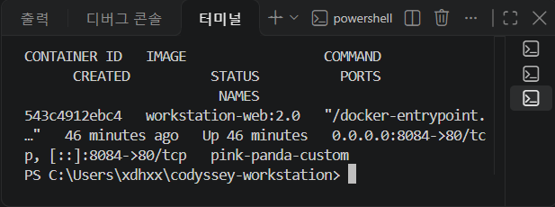
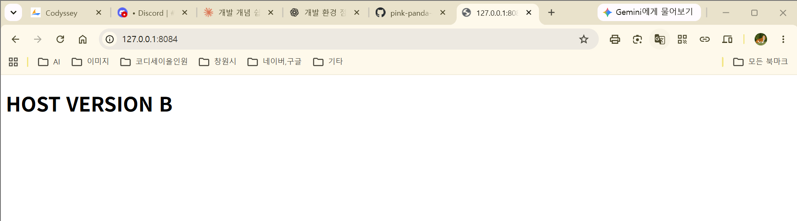
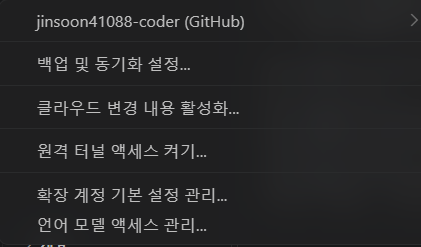
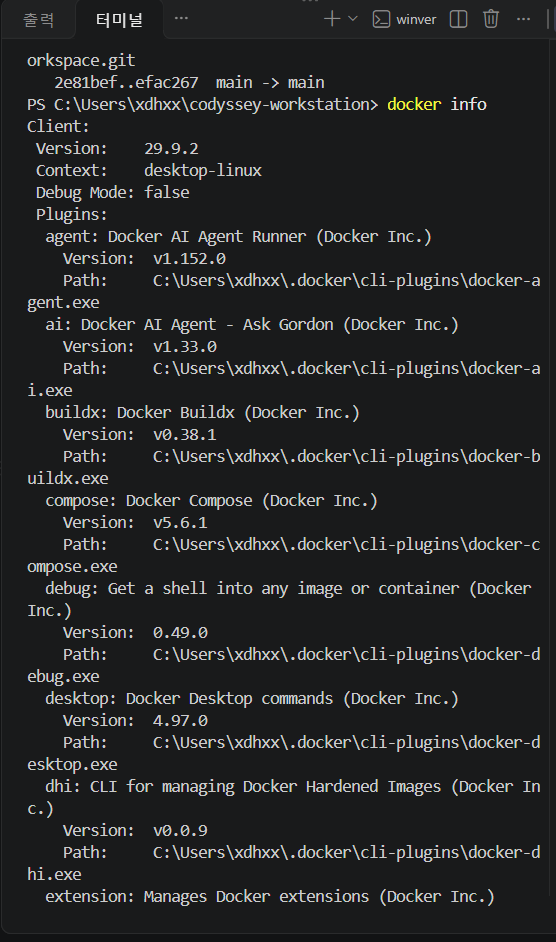
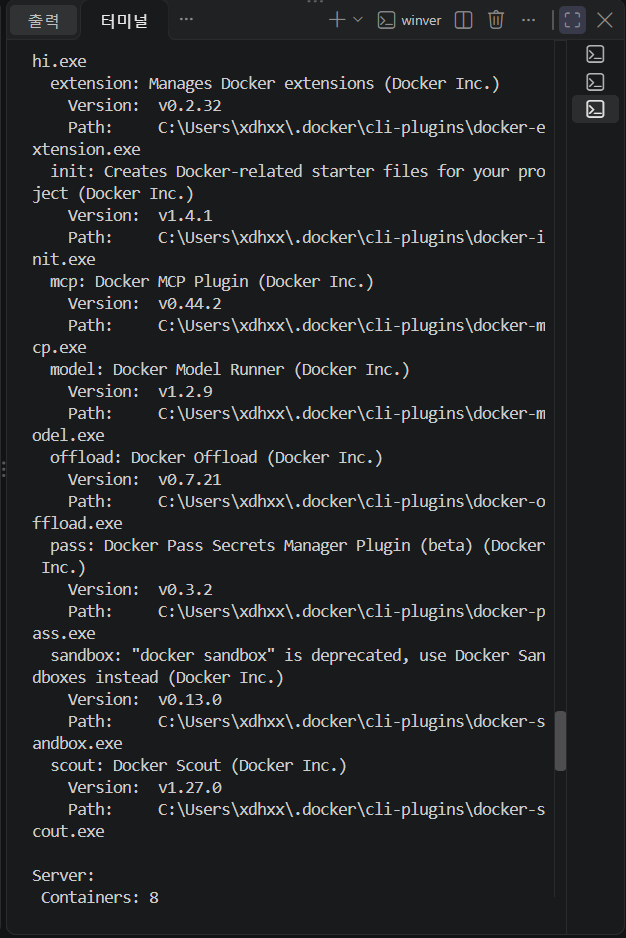
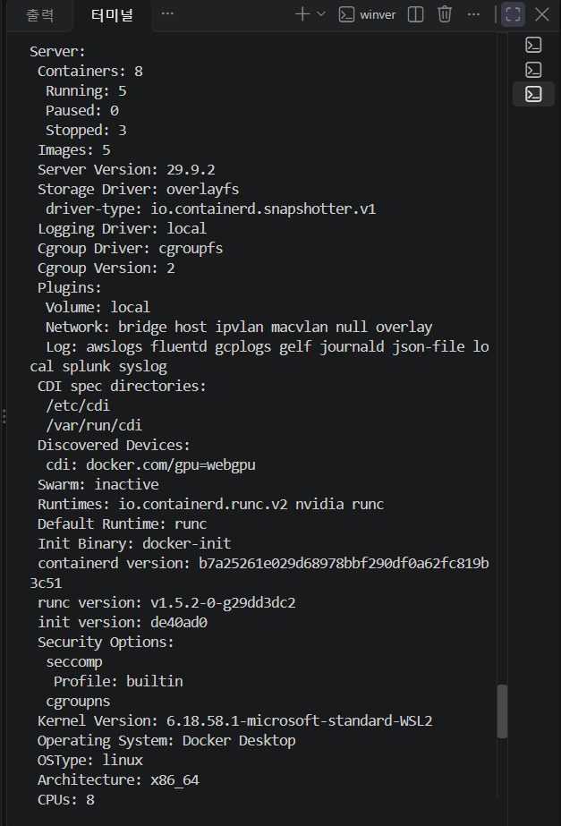
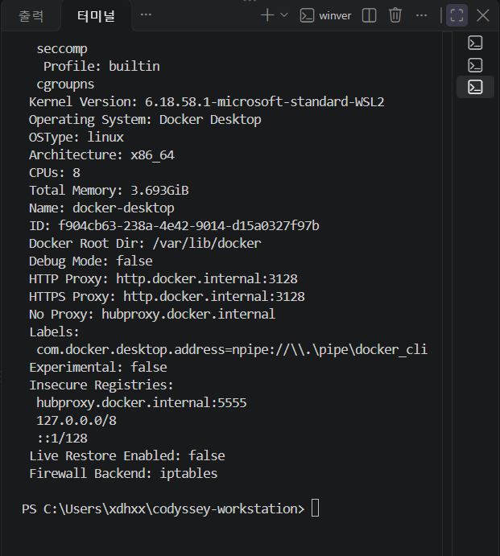

# 개발자용 작업실 구축

## 1. 미션 목표

Windows 로컬 환경에서 PowerShell, Docker, Git을 사용해 개발 환경을 구성하고, Dockerfile 기반 웹 서버의 빌드·실행·포트 매핑·바인드 마운트·볼륨 영속성을 검증한다.

## 2. 실행 환경

| 항목 | 확인 결과 |
|---|---|
| OS | Windows 11 Home 26H2 (Build 26300.10075) |
| 쉘 | Windows PowerShell 5.1 |
| Docker CLI | 29.9.2 |
| Docker Server | 29.9.2 (`linux`) |
| Git | 2.56.0.windows.4 |
| Docker Desktop | Engine running 확인 |

## 3. 수행 체크리스트

- [x] PowerShell 위치·목록·파일 생성·읽기·복사·이름 변경·이동·삭제
- [x] 파일 및 디렉터리 ACL 확인·변경·복원
- [x] Docker 버전·엔진 상태 확인
- [x] `hello-world`, Ubuntu 컨테이너 실행 및 기본 운영 명령
- [x] NGINX 기반 커스텀 이미지 빌드
- [x] 포트 매핑 접속 확인
- [x] 바인드 마운트 변경 반영 확인
- [x] Docker 볼륨 데이터 영속성 확인
- [x] Git 저장소 초기화 및 기본 브랜치 `main` 설정
- [x] GitHub 저장소 연결 및 VS Code 로그인 증거
- [x] README에 스크린샷 증거 추가

## 4. PowerShell 기본 조작 로그

개인 계정 경로는 공개하지 않도록 가렸다.

```powershell
Get-Location
# C:\Users\REDACTED\codyssey-workstation

Get-ChildItem -Force
# 숨김 항목과 일반 항목 목록 확인

New-Item -ItemType Directory -Name cli-practice
Set-Location .\cli-practice
# 작업 폴더 생성 및 이동

Set-Content -Path .\note.txt -Value "CLI practice"
Get-Content -Path .\note.txt
# CLI practice

New-Item -ItemType File -Path .\empty.txt
Get-Item .\empty.txt | Select-Object Name,Length
# empty.txt, Length 0

Copy-Item -Path note.txt -Destination note-copy.txt
Rename-Item -Path note-copy.txt -NewName note-renamed.txt
New-Item -ItemType Directory -Name archive
Move-Item -Path note-renamed.txt -Destination archive
Get-ChildItem -Recurse -Name
# archive\note-renamed.txt 확인

Remove-Item -Path empty.txt
# 직접 만든 연습용 빈 파일 삭제
```

## 5. 권한 실습

Windows에서는 `chmod 755/644` 대신 ACL을 `icacls`로 확인했다. 기존 권한을 확인한 뒤 연습 파일과 폴더에만 임시 권한을 추가하고 제거했다.

```powershell
icacls note.txt
# SYSTEM, Administrators, 현재 사용자: Full Control

icacls note.txt /grant "*S-1-5-32-545:(R)"
# BUILTIN\Users:(R) 추가 확인

icacls note.txt /remove "*S-1-5-32-545"
# 임시 권한 제거 확인

icacls archive /grant "*S-1-5-32-545:(RX)"
# BUILTIN\Users:(RX) 추가 확인

icacls archive /remove "*S-1-5-32-545"
# 임시 권한 제거 확인
```

## 6. Docker 설치 및 기본 운영 로그

```powershell
docker --version
# Docker version 29.9.2, build a82e528

docker info --format 'Server Version: {{.ServerVersion}} | OSType: {{.OSType}}'
# Server Version: 29.9.2 | OSType: linux

docker run --rm hello-world
# Hello from Docker!

docker run -it --name ubuntu-lab ubuntu bash
# 컨테이너 내부에서 실행
pwd
# /
ls
# bin, boot, dev, etc, home, root, tmp, usr 등 표시
echo "Hello from Ubuntu"
# Hello from Ubuntu
exit

docker ps -a --filter "name=ubuntu-lab"
# ubuntu-lab: Exited (0)

docker run -d --name ubuntu-keep ubuntu sleep infinity
docker exec ubuntu-keep bash -lc "echo exec works"
# exec works

docker ps --filter "name=ubuntu-keep"
# ubuntu-keep: Up 상태 확인

docker stats ubuntu-keep
# CPU 0.00%, 메모리 약 7.199 MiB 사용 확인
# Ctrl+C는 통계 표시만 종료하며 컨테이너를 중지하지 않음

docker stop ubuntu-keep
docker ps -a --filter "name=ubuntu-keep"
# 중지 상태 확인

docker run --name log-demo ubuntu bash -lc "echo log-check; echo container-finished"
docker logs log-demo
# log-check
# container-finished

docker images
# hello-world, ubuntu 이미지 확인
```

## 7. Dockerfile 기반 웹 서버

베이스 이미지로 `nginx:alpine`을 선택했다. `site/`의 정적 페이지를 NGINX 웹 루트로 복사하고, 컨테이너 포트 80을 문서화했다.

`web-demo/Dockerfile`:

```dockerfile
FROM nginx:alpine
LABEL org.opencontainers.image.title="workstation-web"
COPY site/ /usr/share/nginx/html/
EXPOSE 80
```

빌드 및 실행:

```powershell
cd web-demo
docker build -t workstation-web:2.0 .
docker run -d --name web-final -p 8082:80 workstation-web:2.0
Invoke-WebRequest -UseBasicParsing http://localhost:8082 |
  Select-Object StatusCode,Content
# StatusCode: 200
# 페이지 내용에 HOST VERSION B 표시
```

`-p 8082:80`은 호스트의 8082 포트를 컨테이너의 80 포트에 연결한다.

## 8. 바인드 마운트 검증

호스트의 `site` 폴더를 컨테이너의 NGINX 웹 루트에 읽기 전용으로 연결했다. 호스트 파일을 변경한 뒤 이미지를 다시 빌드하지 않고도 변경 내용이 응답에 반영됐다.

```powershell
docker run -d --name web-bind -p 8081:80 `
  -v "${PWD}\site:/usr/share/nginx/html:ro" nginx:alpine

# 변경 전: localhost:8081에서 HTTP 200 및 기존 페이지 확인
Set-Content -Path site\index.html `
  -Value '<!doctype html><html><body><h1>HOST VERSION B</h1></body></html>' `
  -Encoding ASCII

Invoke-WebRequest -UseBasicParsing http://localhost:8081 |
  Select-Object StatusCode,Content
# StatusCode: 200
# HOST VERSION B 확인
```

## 9. Docker 볼륨 영속성 검증

컨테이너를 삭제한 뒤에도 같은 볼륨을 연결한 새 컨테이너에서 파일을 읽을 수 있었다.

```powershell
docker volume create workstation-data
docker run -d --name volume-test -v workstation-data:/data ubuntu sleep infinity
docker exec volume-test bash -lc "echo persistent-data > /data/persist.txt; cat /data/persist.txt"
# persistent-data

docker rm -f volume-test
docker run --rm -v workstation-data:/data ubuntu cat /data/persist.txt
# persistent-data
```

## 10. Git 설정 및 GitHub 연동

```powershell
git --version
# git version 2.56.0.windows.4

git config --global --get init.defaultBranch
# main

git init
# codyssey-workstation 저장소 초기화

git status --short --branch
# ## No commits yet on main
```

`git config --list` 결과를 기록할 때는 개인 이름·이메일 등 식별 정보를 가린다. GitHub 저장소 URL과 VS Code 연동이 완료되면 이 섹션에 저장소 링크와 증거를 추가한다. 토큰·비밀번호·개인키는 문서나 스크린샷에 넣지 않는다.
### Git 사용자 설정 확인

- Git 사용자 이름: `pink_panda`
- Git 사용자 이메일: 설정 완료 (개인정보 보호를 위해 비공개)
- Git 기본 브랜치: `main`
- GitHub 원격 저장소: 연결 완료
- GitHub 브랜치 추적: `main` → `origin/main`
- GitHub 업로드: 정상 완료

## 11. 트러블슈팅

1. **Docker 엔진에 연결할 수 없음**
   - 증상: `docker info`에서 `dockerDesktopLinuxEngine` 연결 실패.
   - 원인: Docker Desktop 엔진이 실행되지 않음.
   - 확인: `docker desktop status`에서 Docker Desktop이 실행 중이 아니라고 표시됨.
   - 해결: Docker Desktop을 시작하고 `Engine running` 상태를 확인한 뒤 `docker info` 재검증.

2. **Windows ACL에서 Users 그룹 이름을 찾지 못함**
   - 증상: `BUILTIN\Users` 이름 매핑 오류.
   - 해결: SID `*S-1-5-32-545`로 임시 권한을 부여하고, 확인 후 같은 SID 권한을 제거.

3. **Docker 이미지 빌드 컨텍스트 누락**
   - 증상: `docker buildx build requires 1 argument`.
   - 원인: 빌드 경로 인수 누락.
   - 해결: 현재 폴더를 뜻하는 `.`을 포함해 `docker build -t workstation-web:2.0 .` 실행.


## 12. 증거 자료

### Docker 컨테이너 실행 및 포트 매핑

- [x] Docker 컨테이너 실행 화면
  

- [x] 웹브라우저 포트 매핑 접속 화면 (localhost:8084)
  

### 추가 증거 자료

- [x] Docker 엔진 실행 상태: `screenshots/docker-engine-1.png` ~ `screenshots/docker-engine-4.png`
- [x] VS Code GitHub 로그인 확인: `screenshots/vscode-github.png`



GitHub 저장소:
https://github.com/jinsoon41088-coder/pink-panda-dev-workspace

### Docker 엔진 실행 환경 확인

Docker Client와 Server 버전, 컨테이너 상태 및 실행 환경을 확인한 증거입니다.










---

## 추가 실습: WSL2 Ubuntu Linux 기본 명령어

### 1. 실습 환경

- 실습 날짜: 2026년 11월 24일
- 운영체제: Ubuntu 26.04.1 LTS
- 코드명: Resolute Raccoon
- 실습 환경: WSL2 및 VS Code 터미널

### 2. Ubuntu 설치 및 버전 확인

```powershell
wsl --install -d Ubuntu-26.04
```

```bash
cat /etc/os-release
```

실제 실행 결과:

```text
PRETTY_NAME="Ubuntu 26.04.1 LTS"
NAME="Ubuntu"
VERSION_ID="26.04"
VERSION_CODENAME=resolute
```

### 3. Linux 기본 명령어 실습

| 명령어 | 기능 | 실습 결과 |
|---|---|---|
| pwd | 현재 작업 경로 확인 | 성공 |
| ls -la | 숨김 파일 포함 목록 확인 | 성공 |
| cd | 디렉터리 이동 | 성공 |
| mkdir | 디렉터리 생성 | 성공 |
| touch | 빈 파일 생성 | 성공 |
| echo | 파일 내용 작성 | 성공 |
| cat | 파일 내용 읽기 | 성공 |
| cp | 파일 복사 | 성공 |
| mv | 파일 이름 변경 및 이동 | 성공 |
| rm | 파일 삭제 | 성공 |
| chmod | 파일 및 디렉터리 권한 변경 | 성공 |

### 4. 파일 생성 및 내용 확인

```bash
cd ~
mkdir -p pink-panda-linux-practice
cd pink-panda-linux-practice
touch hello.txt
echo "Hello Pink Panda Linux!" > hello.txt
cat hello.txt
```

실제 출력 결과:

```text
Hello Pink Panda Linux!
```

### 5. 파일 권한 변경 및 복원

변경 전:

```bash
ls -l hello.txt
```

```text
-rw-r--r-- 1 REDACTED REDACTED 0 Nov 24 14:24 hello.txt
```

권한 변경:

```bash
chmod 755 hello.txt
ls -l hello.txt
```

실제 출력 결과:

```text
-rwxr-xr-x 1 REDACTED REDACTED 0 Nov 24 14:24 hello.txt
```

권한 복원:

```bash
chmod 644 hello.txt
ls -l hello.txt
```

실제 출력 결과:

```text
-rw-r--r-- 1 REDACTED REDACTED 24 Nov 24 14:28 hello.txt
```

파일 권한을 644에서 755로 변경한 후 다시 644로 복원하였다.

### 6. 디렉터리 권한 변경

```bash
mkdir permission-test
ls -ld permission-test
```

변경 전:

```text
drwxr-xr-x 2 REDACTED REDACTED 4096 Nov 24 14:26 permission-test
```

```bash
chmod 700 permission-test
ls -ld permission-test
```

변경 후:

```text
drwx------ 2 REDACTED REDACTED 4096 Nov 24 14:26 permission-test
```

디렉터리 권한을 755에서 700으로 변경하여 소유자만 접근할 수 있도록 설정하였다.

### 7. 파일 복사, 이동 및 삭제

```bash
cp hello.txt hello-copy.txt
mv hello-copy.txt hello-renamed.txt
mv hello-renamed.txt permission-test/
ls -l permission-test/
rm permission-test/hello-renamed.txt
ls -la permission-test/
```

삭제 후 실제 출력 결과:

```text
total 8
drwx------ 2 REDACTED REDACTED 4096 Nov 24 14:41 .
drwxr-xr-x 3 REDACTED REDACTED 4096 Nov 24 14:40 ..
```

원본 hello.txt는 정상적으로 유지되었으며 실습용 복사본만 삭제하였다.

### 8. 트러블슈팅

#### 오류 1. Ubuntu 배포판 이름 오타

- 문제: WSL_E_DISTRO_NOT_FOUND 오류 발생
- 가설: Ubuntu 배포판 이름을 잘못 입력했을 가능성
- 확인: Ubntu-26.04로 입력한 것을 확인
- 해결: Ubuntu-26.04로 수정하여 설치 성공

#### 오류 2. 파일 이름 오타

- 문제: No such file or directory 오류 발생
- 가설: 파일 이름이 정확하지 않을 가능성
- 확인: hello.txt 대신 hellotxt로 입력
- 해결: 정확한 파일 이름으로 명령어를 다시 실행하여 성공

#### 오류 3. 파일 이름 변경 후 재실행

- 문제: mv 명령어 실행 시 cannot stat 오류 발생
- 가설: 파일 이름이 이미 변경되었을 가능성
- 확인: ls -la 명령어로 hello-renamed.txt 존재 확인
- 해결: 변경된 파일 이름을 사용하여 이후 실습 진행

### 9. 보안 및 학습 결과

- r은 읽기, w는 쓰기, x는 실행 또는 디렉터리 접근 권한을 의미한다.
- 권한 숫자는 r=4, w=2, x=1의 합으로 계산한다.
- 일반 텍스트 파일은 불필요한 실행 권한을 제거하여 644로 복원하였다.
- 최소 권한의 원칙을 적용하였다.
- 개인정보 보호를 위해 실제 출력 결과의 사용자 계정 이름을 REDACTED로 가렸다.

### 10. 실습 완료 체크리스트

- [x] WSL2 Ubuntu 설치
- [x] Ubuntu 버전 확인
- [x] Linux 기본 명령어 실습
- [x] 절대 경로 및 상대 경로 실습
- [x] 파일 권한 변경 전후 검증
- [x] 디렉터리 권한 변경 전후 검증
- [x] 파일 복사 및 이동
- [x] 파일 삭제 및 원본 유지 확인
- [x] 오류 원인 분석 및 해결
- [x] 최소 권한의 원칙 적용

## 추가 실습: Docker attach와 exec 비교

- 실습 날짜: 2026년 11월 24일
- 실습 장소: 경남대학교
- 실습 환경: Windows PowerShell, VS Code, Docker Desktop

### 1. 실습 목적

- Docker Client와 Server의 정상 작동을 확인한다.
- Ubuntu 이미지를 다운로드하고 컨테이너를 생성한다.
- docker attach와 docker exec의 차이를 이해한다.
- 컨테이너의 실행 상태를 확인한다.
- Docker 접근 권한 오류의 원인과 대응 방법을 이해한다.

### 2. Docker 실행 환경 확인

실행 명령어:

```powershell
docker version
```

실제 출력 결과 중 주요 정보:

```text
Client:
 Version: 29.9.3
 API version: 1.56
 OS/Arch: windows/amd64
 Context: desktop-linux

Server: Docker Desktop 4.99.0 (245822)
 Engine:
  Version: 29.9.3
  API version: 1.56
  OS/Arch: linux/amd64
```

Client와 Server 정보가 모두 출력되어 Docker가 정상적으로 작동하는 것을 확인하였다.

### 3. 기존 컨테이너 확인

```powershell
docker ps -a
```

실제 출력 결과:

```text
CONTAINER ID   IMAGE     COMMAND   CREATED   STATUS    PORTS     NAMES
```

기존 컨테이너가 없는 상태임을 확인하였다.

### 4. Ubuntu 이미지 다운로드 및 컨테이너 생성

```powershell
docker run -dit --name pink-panda-attach-lab ubuntu:latest bash
```

실제 출력 결과:

```text
Unable to find image 'ubuntu:latest' locally
latest: Pulling from library/ubuntu
96aae9022e0e: Pull complete
517b871c26ea: Pull complete
e211d985152c: Download complete
Status: Downloaded newer image for ubuntu:latest
d6587b07b0c18e5238cd052d91e62fdf4affd2a8b25827536d0a3b58360da457
```

Ubuntu 이미지가 로컬에 없었기 때문에 Docker가 자동으로 다운로드하였다.

옵션의 의미:

| 옵션 | 의미 |
| --- | --- |
| -d | 백그라운드 실행 |
| -i | 표준 입력 유지 |
| -t | 가상 터미널 할당 |
| --name | 컨테이너 이름 지정 |

### 5. 컨테이너 실행 상태 확인

```powershell
docker ps
```

실제 출력 결과:

```text
CONTAINER ID   IMAGE           COMMAND   CREATED          STATUS          PORTS     NAMES
d6587b07b0c1   ubuntu:latest   "bash"    23 seconds ago   Up 22 seconds             pink-panda-attach-lab
```

STATUS에 Up이 표시되어 컨테이너가 정상적으로 실행 중임을 확인하였다.

### 6. Docker attach 실습

```powershell
docker attach pink-panda-attach-lab
```

실제 접속 결과:

```text
root@d6587b07b0c1:/#
```

컨테이너 내부에서 실행한 명령어:

```bash
echo "Hello Pink Panda Attach!"
```

실제 출력 결과:

```text
Hello Pink Panda Attach!
```

docker attach는 실행 중인 컨테이너의 기존 메인 프로세스에 연결하는 명령어이다.

### 7. 컨테이너 연결 해제 방법

Docker attach의 기본 연결 해제 단축키는 다음과 같다.

- Ctrl + P
- Ctrl + Q

두 단축키를 순서대로 누르면 컨테이너를 종료하지 않고 연결만 해제할 수 있다.

이번 실습에서는 VS Code 터미널에서 해당 단축키가 정상적으로 작동하지 않았다.

따라서 기존 터미널을 유지하고 새로운 PowerShell 터미널을 열어 다음 실습을 진행하였다.

```powershell
docker ps
```

실제 출력 결과:

```text
CONTAINER ID   IMAGE           COMMAND   CREATED         STATUS         PORTS     NAMES
d6587b07b0c1   ubuntu:latest   "bash"    4 minutes ago   Up 4 minutes             pink-panda-attach-lab
```

컨테이너가 계속 실행되고 있음을 확인하였다.

### 8. Docker exec 실습

새로운 PowerShell 터미널에서 실행하였다.

```powershell
docker exec -it pink-panda-attach-lab bash
```

실제 접속 결과:

```text
root@d6587b07b0c1:/#
```

컨테이너 내부에서 실행한 명령어:

```bash
echo "Hello Pink Panda Exec!"
```

실제 출력 결과:

```text
Hello Pink Panda Exec!
```

docker exec는 실행 중인 컨테이너 내부에서 새로운 프로세스를 실행하는 명령어이다.

### 9. exec 환경 종료

```bash
exit
```

PowerShell로 정상적으로 돌아왔다.

이후 컨테이너의 실행 상태를 다시 확인하였다.

```powershell
docker ps
```

실제 출력 결과:

```text
CONTAINER ID   IMAGE           COMMAND   CREATED         STATUS         PORTS     NAMES
d6587b07b0c1   ubuntu:latest   "bash"    5 minutes ago   Up 5 minutes             pink-panda-attach-lab
```

exec로 실행한 bash를 종료해도 기존 컨테이너는 계속 실행되고 있음을 확인하였다.

### 10. Docker attach와 exec 비교

| 구분 | docker attach | docker exec |
| --- | --- | --- |
| 연결 대상 | 기존 메인 프로세스 | 새로운 프로세스 |
| 프로세스 추가 생성 | 하지 않음 | 생성함 |
| 이번 실습에서 exit 실행 시 | 메인 bash와 컨테이너 종료 | 새 bash만 종료 |
| 주요 목적 | 기존 프로세스 연결 | 추가 작업 및 점검 |

쉽게 설명하면 attach는 기존 작업 환경에 연결하는 것이고, exec는 실행 중인 컨테이너 내부에 새로운 작업 환경을 만드는 것이다.

### 11. 트러블슈팅: WSL2 Docker 접근 권한 오류

#### 문제

Ubuntu 터미널에서 다음 명령어를 실행하였다.

```bash
docker version
```

발생한 오류:

```text
permission denied while trying to connect to the docker API at unix:///var/run/docker.sock
```

#### 원인 가설

현재 Ubuntu 사용자에게 Docker 소켓 접근 권한이 없을 것으로 판단하였다.

#### 확인 과정

```bash
groups
```

출력 결과:

```text
[USERNAME] adm cdrom sudo dip plugdev users
```

현재 사용자 그룹에 docker 그룹이 포함되어 있지 않았다.

```bash
ls -lL /var/run/docker.sock
```

실제 출력 결과:

```text
srw-rw---- 1 root docker 0 Nov 24 15:29 /var/run/docker.sock
```

Docker 소켓의 소유자는 root이고 소유 그룹은 docker임을 확인하였다.

#### 대응 방법

Docker 그룹에 사용자를 추가하는 방법을 검토하였다.

```bash
sudo usermod -aG docker $USER
```

하지만 관리자 비밀번호를 확인할 수 없어 권한 변경 절차를 중단하였다.

학교 컴퓨터의 보안을 고려하여 관리자 권한을 강제로 변경하지 않았다.

대신 Windows PowerShell로 전환하여 Docker Client와 Server의 정상 작동을 확인하고 나머지 실습을 진행하였다.

Ubuntu의 접근 권한 문제는 해결되지 않은 상태이며, PowerShell을 이용하여 실습을 완료하였다.

### 12. 트러블슈팅: Docker 명령어 오타

#### 문제

```bash
docker uersion
```

발생한 오류:

```text
docker: unknown command: docker uersion
```

#### 원인

version의 첫 글자인 v를 u로 잘못 입력하였다.

#### 해결 방법

```bash
docker version
```

정확한 명령어로 수정하여 Docker Client 정보를 확인하였다.

### 13. 트러블슈팅: attach 연결 해제 단축키 문제

#### 문제

VS Code 터미널에서 Ctrl + P, Ctrl + Q 단축키가 작동하지 않았다.

#### 원인 가설

VS Code 자체 단축키와 Docker 연결 해제 단축키가 충돌했을 가능성이 있다.

#### 대응 방법

기존 attach 터미널을 유지한 상태에서 새로운 PowerShell 터미널을 열었다.

docker ps 명령어로 컨테이너 실행 상태를 확인하고 docker exec 실습을 진행하였다.

#### 결과

컨테이너를 종료하지 않고 나머지 실습을 완료하였다.

### 14. 보안 및 주의 사항

- 관리자 비밀번호를 문서에 기록하지 않는다.
- 개인 사용자 정보는 필요한 경우 마스킹한다.
- 학교 컴퓨터의 권한을 임의로 변경하지 않는다.
- Docker 그룹이 강력한 시스템 권한을 가질 수 있음을 이해한다.
- 기존 컨테이너를 함부로 삭제하지 않는다.

### 15. 학습 결과 체크리스트

- [x] Docker Desktop 버전 확인
- [x] Docker Client 및 Server 버전 확인
- [x] 기존 컨테이너 확인
- [x] Ubuntu 이미지 다운로드
- [x] Ubuntu 컨테이너 생성
- [x] 컨테이너 실행 상태 확인
- [x] Docker attach 접속
- [x] attach 내부 명령어 실행
- [x] Docker exec 접속
- [x] exec 내부 명령어 실행
- [x] exec 환경 종료
- [x] 컨테이너 실행 유지 확인
- [x] attach와 exec 차이 이해
- [x] Docker 접근 권한 오류 원인 확인
- [x] PowerShell을 이용한 대체 실습
- [x] 트러블슈팅 과정 기록
- [x] 보안 및 권한 관리 원칙 이해
- [ ] attach 기본 단축키를 이용한 연결 해제 성공
- [ ] WSL2 Docker 접근 권한 문제 해결

---

## 추가 실습: Git 사용자 설정 및 개인정보 보호

- 실습 날짜: 2026년 11월 24일
- 실습 장소: 경남대학교
- 실습 환경: Windows PowerShell, VS Code
- 프로젝트: pink-panda-dev-workspace

### 1. 실습 목적

- Git 사용자 이름과 이메일 설정을 확인한다.
- 기본 브랜치 설정과 현재 브랜치의 차이를 이해한다.
- Git 전체 설정 목록을 확인한다.
- 개인정보와 인증 정보를 안전하게 보호한다.
- Git 로컬 설정과 전역 설정의 차이를 이해한다.

### 2. Git 사용자 이름 확인

실행 명령어:

```powershell
git config --get user.name
```

실제 출력 결과:

```text
pink_panda
```

Git 사용자 이름은 커밋을 작성한 사람이 누구인지
기록하기 위해 사용한다.

### 3. Git 이메일 설정 확인

실행 명령어:

```powershell
git config --get user.email
```

실제 출력 결과 (개인정보 마스킹):

```text
[REDACTED]@users.noreply.github.com
```

GitHub에서 제공하는 noreply 이메일을 사용하여
개인 이메일 주소가 커밋에 공개되지 않도록 설정하였다.

### 4. 기존 기본 브랜치 설정 확인

실행 명령어:

```powershell
git config --get init.defaultBranch
```

실제 출력 결과:

```text
master
```

기존 기본 브랜치 설정은 master였다.

현재 프로젝트에서 사용 중인 브랜치는 main이다.

기본 브랜치 설정과 현재 브랜치는 서로 다른 개념이다.

### 5. 로컬 기본 브랜치 설정 변경

실행 명령어:

```powershell
git config --local init.defaultBranch main
```

실행 결과:

- 오류 없이 PowerShell 입력창으로 돌아왔다.
- 현재 저장소의 로컬 설정값을 변경하였다.
- 기존 파일과 커밋은 변경하지 않았다.
- 다른 저장소의 설정에는 영향을 주지 않았다.

### 6. 변경된 설정 확인

실행 명령어:

```powershell
git config --get init.defaultBranch
```

실제 출력 결과:

```text
main
```

현재 저장소에서 조회되는 기본 브랜치 설정값이
main으로 변경된 것을 확인하였다.

이 설정은 현재 브랜치의 이름을 변경하는 명령이 아니며,
다른 신규 저장소의 전역 기본값도 변경하지 않는다.

### 7. Git 전체 설정 확인

실행 명령어:

```powershell
git config --list
```

Git 사용자 정보, 브랜치, 원격 저장소,
인증 관련 설정 등을 확인하였다.

출력 화면에서 q 키를 눌러 PowerShell로 돌아왔다.

### 8. 개인정보 마스킹

개인정보와 인증 정보가 공개되지 않도록
허용된 설정값만 표시하고 나머지는 마스킹하였다.

실행 명령어:

```powershell
git -P config --list | ForEach-Object { if ($_ -match '^(init\.defaultbranch=(main|master)|core\.(autocrlf|filemode|bare)=(true|false)|branch\.main\.remote=origin|branch\.main\.merge=refs/heads/main)$') { $_ } else { ($_ -split '=',2)[0] + '=[REDACTED]' } }
```

실제 출력 결과:

```text
diff.astextplain.textconv=[REDACTED]
filter.lfs.clean=[REDACTED]
filter.lfs.smudge=[REDACTED]
filter.lfs.process=[REDACTED]
filter.lfs.required=[REDACTED]
http.sslbackend=[REDACTED]
core.autocrlf=true
core.fscache=[REDACTED]
core.symlinks=[REDACTED]
pull.rebase=[REDACTED]
credential.helper=[REDACTED]
credential.https://dev.azure.com.usehttppath=[REDACTED]
init.defaultbranch=master
user.name=[REDACTED]
core.repositoryformatversion=[REDACTED]
core.filemode=false
core.bare=false
core.logallrefupdates=[REDACTED]
core.symlinks=[REDACTED]
core.ignorecase=[REDACTED]
remote.origin.url=[REDACTED]
remote.origin.fetch=[REDACTED]
branch.main.remote=origin
branch.main.merge=refs/heads/main
branch.main.vscode-merge-base=[REDACTED]
user.name=[REDACTED]
user.email=[REDACTED]
credential.helper=[REDACTED]
init.defaultbranch=main
```

REDACTED는 중요한 정보가 가려졌다는 의미이다.

### 9. 주요 Git 설정의 의미

| 설정 항목 | 의미 |
| --- | --- |
| user.name | 커밋 작성자 이름 |
| user.email | 커밋 작성자 이메일 |
| init.defaultBranch | 저장소 초기 브랜치 이름 설정 |
| core.autocrlf | 운영체제 간 줄바꿈 처리 설정 |
| core.filemode | 파일 실행 권한 변경 추적 여부 |
| core.bare | 작업 디렉터리가 없는 저장소인지 여부 |
| remote.origin.url | 원격 저장소 주소 |
| branch.main.remote | main 브랜치가 연결된 원격 저장소 |
| branch.main.merge | 추적하는 원격 브랜치의 참조 |
| credential.helper | Git 인증 정보 관리 도구 |

### 10. Git 설정 범위의 차이

| 설정 범위 | 적용 대상 |
| --- | --- |
| --system | 컴퓨터의 시스템 수준 Git 설정 |
| --global | 현재 사용자의 Git 설정 |
| --local | 현재 Git 저장소의 설정 |

일반적으로 동일한 설정이 여러 범위에 존재하면
로컬 설정이 전역 및 시스템 설정보다 우선한다.

학교 컴퓨터이므로 다른 프로젝트에 영향을 주지 않도록
현재 저장소의 로컬 설정을 사용하였다.

### 11. 트러블슈팅: 개인정보 마스킹 문제

#### 문제

첫 번째 마스킹 과정에서 한글 사용자 이름이 깨지고
개인 이메일 주소가 같은 출력 줄에 나타났다.

#### 원인 가설

문자 인코딩 또는 출력 줄 처리 문제로 인해
사용자 이름과 이메일 정보가 같은 줄에 포함되었을
가능성이 있다고 판단하였다.

#### 확인 과정

- Git 전체 설정 목록을 확인하였다.
- 마스킹된 출력 결과를 검토하였다.
- 일부 개인정보가 가려지지 않은 것을 발견하였다.

#### 해결 방법

- 사용자 이름을 포함한 민감한 설정값을 가렸다.
- 안전한 설정 항목과 값만 허용하도록 조건을 변경하였다.
- 마스킹 명령어를 다시 실행하였다.
- 출력 결과에 개인 이메일 주소가 없는 것을 확인하였다.

#### 해결 결과

개인정보가 가려진 Git 설정 목록을 확보하였다.

### 12. 보안 및 주의 사항

- 개인 이메일 주소를 공개 문서에 기록하지 않는다.
- GitHub noreply 이메일을 활용한다.
- 비밀번호와 API 토큰을 GitHub에 업로드하지 않는다.
- 인증 관련 설정값은 필요한 경우 마스킹한다.
- 학교 컴퓨터의 전역 설정을 임의로 변경하지 않는다.
- Git 설정 출력 결과를 공개하기 전에 직접 검토한다.

### 13. 학습 결과 체크리스트

- [x] Git 사용자 이름 확인
- [x] Git 이메일 설정 확인
- [x] GitHub noreply 이메일 사용 확인
- [x] 기존 기본 브랜치 설정 확인
- [x] 로컬 기본 브랜치 설정 변경
- [x] 변경된 설정값 확인
- [x] Git 전체 설정 목록 확인
- [x] 개인정보 마스킹
- [x] 마스킹 문제 해결
- [x] Git 설정 범위의 차이 이해
- [x] 보안 및 개인정보 보호 원칙 이해
- [x] Git 설정 실습 과정 문서화